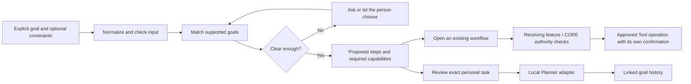

# ZURI Intent Engine — first working contract

An intent is the person's desired outcome, not a message, permission grant or
completed operation. The engine proposes a path through existing ZURI features.
Viola can discuss goals, CORE enforces identity and consent, and the receiving
Tool or feature enforces its operation-specific requirements.

## Built

- Canonical dependency-free package `packages/intent-engine`, consumed by the
  website directly and the app as a versioned local npm package. Same catalogue,
  request schema and plan contract in both surfaces.
- Outcome families for developer Tools, Invites, software, automation, security,
  business software setup, business presence, bookings, discovery, personal
  planning, sharing, Chapters and technology learning.
- Conservative rule matching, explicit outcome selection, negation handling and
  clarification for ambiguous goals, nearby areas and booking audience. Match
  basis is disclosed; there are no invented confidence percentages. This is not
  general language understanding.
- Static, known workflow destinations. Caller-supplied role, permissions,
  confirmation flags, action payloads and generated URLs cannot grant authority.
- Website `/intent`, linked from home and Tech. Local planning makes no API or
  provider call. App handoff deliberately does not put the private goal in a URL. An explicit copy action transfers an unsaved draft through same-tab sessionStorage for review.
- App goal planner at `#/lounge?kind=intent&id=new`, accessible from the Lounge
  goal input and desktop workspace rail. Saved goals have bounded event history,
  revision, lifecycle state and a linked personal task.
- One task per saved goal, exact-payload confirmation, current saved-goal revision
  binding, stale-review rejection and duplicate-click protection. Marking a goal
  complete or cancelling it does not alter tasks or external records.
- Local backup read/merge/export includes validated goal records. Removing a goal
  retains its linked task. Private goals are not copied to public profiles, used
  for advertising/hiring signals or mined from chats and Lore.
- Stateless `/api/intents/resolve` GET/POST contract and Tool SDK 0.2.0
  `zuri.intents.resolve`. Explicit SDK input is sent to ZURI; the endpoint makes no
  provider call, stores no goal and cannot execute actions. Review the supplied
  data before using a remote planning endpoint.

## Request and response

Input: `text` (3–1500 characters), surface (`app` or `website`), optional known
goal ID, and explicitly supplied audience/area/budget/calendar date. Unknown fields
are discarded. Known secret patterns and invalid dates are rejected; this is not
a complete secret/PII detector. Never include passwords or access keys.

Output: engine version, normalized request, proposed interpretation, match basis,
`ready` / `clarify` / `blocked`, question, alternative goals, proposed steps,
prerequisites and a bounded action list. “Ready” means ready to explore the proposed
path, not approved to perform an external operation. People can correct a matched
direction without rewriting the whole goal.

Navigation is re-derived from the current catalogue. A modified plan cannot
substitute an arbitrary destination. Creating a personal task requires a review
of the normalized goal and exact title/date; the local adapter checks the current
saved-goal revision/status again before writing.

## Execution and trust

There is no generic `execute(plan)` endpoint. No planner-to-booking or
planner-to-publishing shortcut was added. A connected Tool must still have its
approved version, active installation, explicit Space consent, narrow capability,
canonical manager authority and any required spending allowance. Opening a Tool
catalogue does not prove that a suitable approved Tool or an available slot exists.

The app adapter writes only directly reviewed personal local state. Its records
are not server authorization or an audit service. Existing browser storage is not
encrypted; exported backups include private goals. Unsaved input stays in React memory unless the person explicitly copies it to the app. That handoff uses same-tab sessionStorage, is rejected after five minutes and is consumed on opening the new-goal screen. There is no expiry background job; an unconsumed draft can remain until tab close/browser restore. It is never placed in the URL, scanned from the workspace or automatically sent to Viola. The existing Viola conversation-review boundary remains separate.

Saved records retain the request and real local decisions, not executable model
output. Reopening a goal resolves the current catalogue; old linked tasks are not
silently rewritten. Cloud synchronization, shared-team intent records, public
intent discovery, recurring agents and cross-Tool orchestration are not enabled.

## SDK and packaging

The standalone app uses `vendor/zuri-intent-engine-0.1.0.tgz` and a local file npm
dependency, so it does not require the website source folder to run. To change
the shared engine, update/version the canonical package, pack it into the app's
vendor directory and reinstall the tarball. `build:app` verifies the installed
engine's source equals the website's canonical source before producing a website
edition. Do not permit the two versions to drift silently.

Rebuild app assets with `npm run build:app`; regenerate the downloadable Tool SDK
with `npm run pack:sdk`. The latter is now version 0.2.0. The previous 0.1.0 SDK
download is retained. No package has been published to the public npm registry.

## Verification and next boundary

Tests cover supported matching, ambiguity, explicit corrections, negation,
malformed input, known secret patterns, invalid dates, forged authority/actions,
fixed destinations, app/website consistency, exact task review, stale goal
revisions, duplicates, backup recovery and cancellation/removal semantics.

Broader semantic interpretation can later produce a candidate using this contract,
but it must be validated and reviewed as a proposal. Paid provider inference must
use explicit reviewed context and the correct billing party. It must not turn
model text into authorization. Multi-user server persistence, permissions,
background scheduling and real Tool outcomes need their own separately tested
services before they can be promised.
